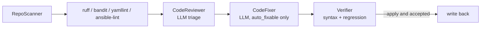

# local-autofix

**Code review and auto-fix for Python and Ansible/YAML** — real linters plus a local LLM,
and every fix is verified before it is written. Runs against your own Ollama, vLLM or
llama.cpp servers; no code leaves your machine.

-   :material-rocket-launch: **[Quick start](quickstart.md)**

    `pip install -r requirements.txt`, point `config.yaml` at Ollama, dry run.

-   :material-cog: **[config.yaml](configuration.md)**

    Endpoints, model, context sizing, retries and circuit breaker.

-   :material-server-network: **[Several Ollama servers](multi-server.md)**

    Round-robin endpoints plus `--workers` for real parallel reviews.

-   :material-lifebuoy: **[Troubleshooting](troubleshooting.md)**

    Slow requests, cold models and known limitations.

## Features

| Feature | What you get |
|---|---|
| **Grounded findings** | The LLM triages real linter output and adds what linters can't see |
| **Conservative fixes** | Only issues marked `auto_fixable` are fixed, unless you pass `--include-risky` |
| **Verified writes** | A fix must still parse and must not add findings, or the file is left alone |
| **Dry run by default** | Reports only; `--apply` writes fixes and keeps backups |
| **Multiple backends** | Ollama, vLLM or llama.cpp (`llama-server`) |
| **Resilient client** | Retries, dynamic `num_ctx`, round-robin, circuit breaker, heartbeat logging |
| **Jinja-aware** | Ansible templates are validated as Jinja2, not as plain YAML |
